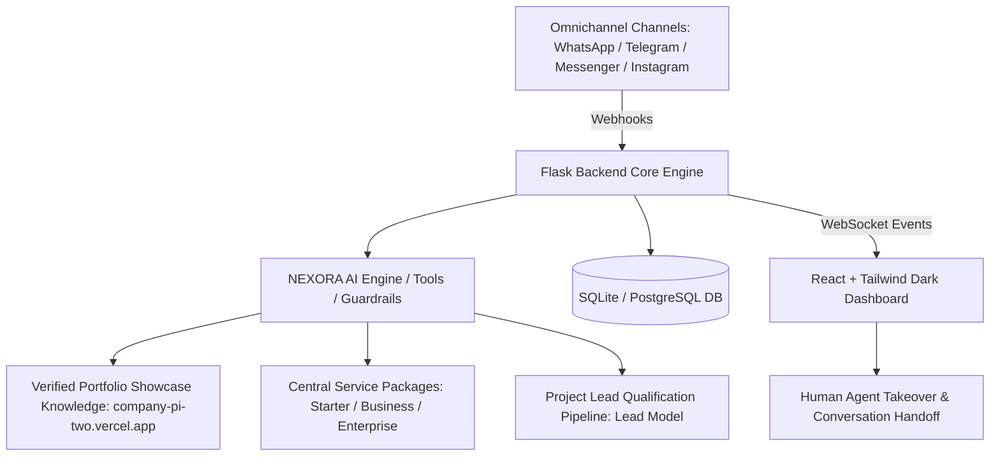

# 🚀 NEXORA AI Customer Service Platform
## Enterprise Omnichannel AI Customer Support & Lead Qualification Platform for NEXORA Software Solutions
**Brand Tagline:** *Ideas → Code → Impact*

A modern, production-grade AI customer service and sales pipeline platform built specifically for **NEXORA Software Solutions** — a premier software development company specializing in professional websites, custom web applications, artificial intelligence solutions, intelligent WhatsApp/Telegram chatbots, and enterprise workflow automation.

---

## 🌐 Official Company References & Links

* **Official Portfolio & Showcase:** [https://company-pi-two.vercel.app/](https://company-pi-two.vercel.app/)  
  *(Integrated directly into the AI assistant, quick replies, and top navigation)*
* **Facebook Page:** [https://www.facebook.com/profile.php?id=61595024167397](https://www.facebook.com/profile.php?id=61595024167397)
* **Instagram Profile:** [https://www.instagram.com/nexorasoftwarre/](https://www.instagram.com/nexorasoftwarre/)
* **Live Service Endpoint (Railway):** [https://ai-whats-production.up.railway.app/](https://ai-whats-production.up.railway.app/)
* **Verified Contacts:**
  * **Phone / WhatsApp:** `+20 155 644 1133`
  * **Email:** `contact@nexorasolutions.com`
  * **Headquarters:** Cairo, Egypt
  * **Working Hours:** Sunday – Thursday, 9:00 AM – 6:00 PM (Cairo Time, UTC+2)

---

## 🏛️ System Architecture & Core Capabilities



### 1. Dedicated NEXORA AI Persona & Guardrails
* **Context-Aware Software Assistant:** Identifies as NEXORA's virtual customer service assistant. Naturally welcomes clients, diagnoses technical requirements, explains service packages, and progressively captures project leads.
* **Bilingual Arabic & English Support:** Speaks native Egyptian Arabic, Modern Standard Arabic, and English depending on customer preference.
* **Verified Portfolio Ingestion:** Responds directly to portfolio inquiries by sharing `https://company-pi-two.vercel.app/` alongside specific verified showcase projects (Travel Aura, La Casa Fine Dining, Vanta Streetwear, Aether Void 00).
* **Strict Price Honesty:** Clearly marks Starter and Business packages as proposed indicative estimates (`is_approved=False`), explicitly stating that final quotations depend on project requirements and scope.
* **Anti-Leakage Guardrails:** Automatic sanitizer purges legacy physical product terms (olive oil, herbs, shipping thresholds) to ensure zero brand contamination.

### 2. Software Service Packages & Administrative Management
* **Starter Package (Proposed 8,000 – 12,000 EGP):** Single landing page, mobile-first responsive layout, WhatsApp inquiry integration, basic SEO, 2 weeks post-launch support. *(Marked unapproved until officially confirmed)*.
* **Business Package (Proposed 20,000 – 35,000 EGP - Most Popular):** Multi-page website or small business web app (up to 5 pages), bilingual Arabic/English, portfolio showcase, analytics, SEO optimization, 1 month support. *(Marked unapproved until officially confirmed)*.
* **Enterprise & Custom Solutions (Custom Quotation):** Custom software architecture, AI chatbots/agents, backend APIs, n8n/webhook automations, CRM integrations, dedicated scalability & priority SLA.

### 3. Project Leads & Inquiries Pipeline
* Replaces physical e-commerce cart/checkout workflows with a software project lead qualification system.
* Captures client contact info, business name, industry, requested services, budget range, expected timeline, and lead source.
* Full lead status pipeline: `New` ➔ `Qualified` ➔ `Awaiting Human Review` ➔ `Contacted` ➔ `Closed`.

### 4. Seamless Human Handoff & Omnichannel Synchronization
* Automated intent detection escalates complex inquiries or direct customer requests to human engineers (`ai_status: human_handled`).
* Real-time WebSocket broadcasts notify dashboard staff immediately.
* Human agents can reply directly or toggle AI back on with a single click.

---

## 🛠️ Technology Stack

* **Backend:** Python 3.11+ / 3.14, Flask, Flask-SQLAlchemy, Flask-JWT-Extended, Flask-SocketIO, Flask-CORS.
* **Frontend:** React 18, Vite, Tailwind CSS (Custom Dark Mode & RTL Support), Lucide Icons, Socket.IO Client.
* **Database:** SQLite (Local Development) / PostgreSQL 15+ (Production via SQLAlchemy).
* **AI Providers:** OpenAI-compatible API abstraction (OpenAI, Groq, Mistral, Ollama, or built-in local rule engine fallback).

---

## ⚙️ Local Installation & Setup (Windows PowerShell)

### Prerequisites
* Python 3.11+ installed and available on PATH
* Node.js v18+ and npm installed

### Step 1: Clone and Set Up Backend Virtual Environment
Open Windows PowerShell in the project root:

```powershell
cd C:\Users\Andalus\Desktop\ai-zait\backend

# Create virtual environment if not already created
python -m venv venv

# Activate virtual environment
.\venv\Scripts\Activate.ps1

# Install required dependencies
pip install -r requirements.txt
```

### Step 2: Configure Environment Variables
Copy the template configuration file:
```powershell
Copy-Item .env.example .env
```
Ensure key environment variables in `backend/.env` are properly set:
```env
FLASK_ENV=development
SECRET_KEY=nexora_production_super_secret_jwt_key_2026_x99!
JWT_SECRET_KEY=nexora_jwt_secret_key_production_2026_secure!
SQLALCHEMY_DATABASE_URI=sqlite:///khams_sinaa.db

# NEXORA Company Profile & Portfolio
COMPANY_NAME=NEXORA Software Solutions
COMPANY_TAGLINE=Ideas → Code → Impact
PORTFOLIO_URL=https://company-pi-two.vercel.app/

# AI Provider Configuration
AI_PROVIDER=groq
AI_MODEL=llama-3.3-70b-versatile
AI_API_KEY=your_groq_or_openai_api_key_here
```

### Step 3: Run Database Migration & Seeding
Execute the safe migration script and seed NEXORA records:

```powershell
# Run the database migration (creates backup and adds NEXORA tables)
.\venv\Scripts\python app\utils\migrate_to_nexora.py

# Run idempotent database seeding
.\venv\Scripts\python app\utils\seed.py
```

### Step 4: Start Backend Server
```powershell
.\venv\Scripts\python run.py
```
*Backend will run at:* `http://localhost:5000`

### Step 5: Install and Run Frontend Dashboard
In a second Windows PowerShell terminal:

```powershell
cd C:\Users\Andalus\Desktop\ai-zait\frontend

# Install dependencies
npm install

# Start Vite development server
npm run dev
```
*Frontend will run at:* `http://localhost:5173`

---

## 🔑 Administrative Demo Logins

Seeded development staff accounts for NEXORA:

| Role | Email | Password | Scope |
| :--- | :--- | :--- | :--- |
| **Admin** | `admin@nexorasolutions.com` | `admin123` | Full administrative control, package editing, settings |
| **Manager** | `manager@nexorasolutions.com` | `manager123` | Leads management, analytics, knowledge base |
| **Agent** | `agent1@nexorasolutions.com` | `agent123` | Customer inbox, live human handoff, chat replies |
| **Agent** | `agent2@nexorasolutions.com` | `agent223` | Customer inbox, live human handoff, chat replies |

---

## 🧪 Running Automated Tests

A comprehensive automated test suite (39 tests) verifies end-to-end functionality:

```powershell
cd C:\Users\Andalus\Desktop\ai-zait\backend
.\venv\Scripts\python -m pytest
```

### Test Coverage Summary:
* `test_nexora_identity.py`: Company settings, portfolio URL (`https://company-pi-two.vercel.app/`), verified contacts, and backward compatibility.
* `test_service_packages.py`: Starter, Business (popular), Enterprise packages, indicative pricing approval toggles, CRUD operations.
* `test_leads.py`: Lead creation, contact info validation, status progression (`New` ➔ `Qualified` ➔ `Closed`), and query filtering.
* `test_seed_idempotency.py`: Fresh database initialization, zero duplicate records on repeated execution, and legacy product deactivation.
* `test_ai_nexora.py`: Arabic & English portfolio responses, indicative price notices, AI solution inquiries, human escalation, and anti-leakage sanitization.
* `test_auth.py`: JWT login success and failure handling for `@nexorasolutions.com`.
* `test_conversations.py`: Omnichannel conversation access controls.
* `test_handoff.py`: Real-time human takeover, AI status switching, and race-condition prevention.
* `test_products.py`: Query isolation ensuring old-business products are excluded from active results.
* `test_webhooks.py`: WhatsApp webhook challenge verification and Telegram webhook routing.

---

## 🌐 Channel Integration Guides

### 1. WhatsApp Business Cloud API
1. Create a Meta Developer App with **WhatsApp Business Cloud API** product.
2. Set Webhook Callback URL: `https://your-domain.com/api/webhooks/whatsapp`
3. Set Verify Token to match `WHATSAPP_VERIFY_TOKEN` (configured in `.env`).
4. Subscribe to the `messages` webhook field.
5. Provide `WHATSAPP_ACCESS_TOKEN` and `WHATSAPP_PHONE_NUMBER_ID` in `.env`.

### 2. Telegram Bot API & Live Deployment
* **Live Service Endpoint:** `https://ai-whats-production.up.railway.app/`
* In Telegram, chat with `@BotFather` to generate a bot token, then set `TELEGRAM_BOT_TOKEN` in `.env`.
* Set your webhook via:
  ```powershell
  curl -X POST "https://api.telegram.org/bot<YOUR_TELEGRAM_BOT_TOKEN>/setWebhook?url=https://your-domain.com/api/telegram/webhook"
  ```

### 3. Facebook Messenger & Instagram Direct
1. Connect your Instagram Professional account to your Facebook Business Page.
2. Set Webhook Callback URL to `https://your-domain.com/api/webhooks/messenger` or `/instagram`.
3. Configure `FACEBOOK_PAGE_ACCESS_TOKEN` and `INSTAGRAM_ACCESS_TOKEN`.

---

## 🔔 Web Push (VAPID) & iPhone PWA Setup

NEXORA includes native Web Push Notifications (RFC 8292) supporting desktop browsers and iPhones running **iOS 16.4+**.

### 1. Generating VAPID Keys
To generate a compliant VAPID keypair:
```powershell
.\venv\Scripts\python.exe generate_vapid_keys.py
```
Copy the generated values to your `.env` file:
```env
VAPID_PUBLIC_KEY=BKS2unBwvA_pXKtcQoVH7Ql7J6tQ7k6957TyeqZ0Q_k_LThHobxryq6nBec0MAZ868S_pwFCGcZbHbzXAJWC9Ig
VAPID_PRIVATE_KEY=xGN3v39NwEHJgQ8I6lSBZMN39NACyL1JrelYKri1x7k
VAPID_CLAIM_EMAIL=mailto:contact@nexorasolutions.com
```

### 2. iPhone (iOS 16.4+) Acceptance Testing Procedure
1. Open the deployed HTTPS URL in **Safari** on your iPhone.
2. Tap the **Share (مشاركة)** button at the bottom of Safari.
3. Select **Add to Home Screen (إضافة إلى الصفحة الرئيسية)**.
4. Launch the installed **NEXORA** web app from your iPhone Home Screen (running in standalone mode).
5. Log in to your account and navigate to **الإعدادات (Settings) -> إشعارات Web Push**.
6. Tap **تفعيل الإشعارات على هذا الجهاز (Enable Notifications)**.
7. Allow notifications when prompted by iOS.
8. Tap **إرسال إشعار تجريبي (Send Test Push)** to verify that lockscreen and banner notifications arrive.
9. Send a message to your connected WhatsApp Business or Telegram bot; the incoming message will trigger an immediate push notification.
10. Tapping the push notification will navigate directly to the relevant conversation in the mobile inbox.

---

## 🔄 Database Migration & Rollback Procedures

### Performing Migrations
The migration runner automatically creates a timestamped SQLite backup in `backend/` before executing schema modifications:
```powershell
python app\utils\migrate_to_nexora.py
```

### Rollback Procedure
If a rollback is required in SQLite development:
1. Stop the backend server.
2. Locate the backup file (e.g., `backend/khams_sinaa_backup_<TIMESTAMP>.db`).
3. Restore the database:
   ```powershell
   Copy-Item backend\khams_sinaa_backup_<TIMESTAMP>.db backend\khams_sinaa.db -Force
   ```
4. Restart the backend server.

---

## 📄 License
Production-ready software custom-built for **NEXORA Software Solutions** (Ideas → Code → Impact). All rights reserved 2026.
